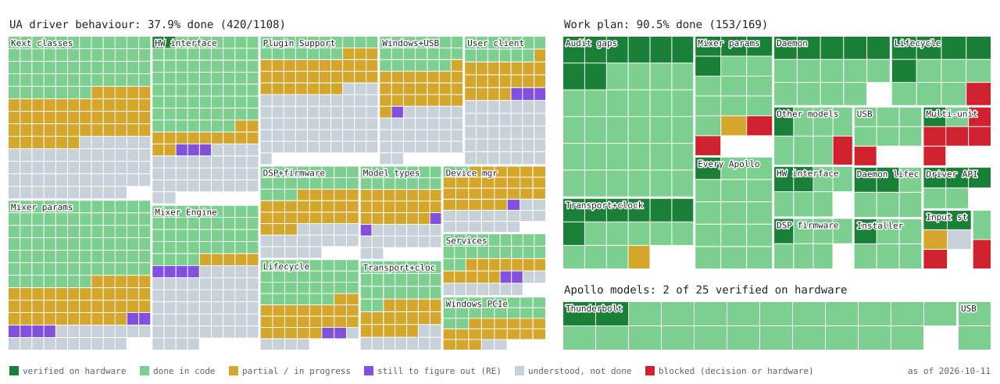

[](https://github.com/rolotrealanis98/open-apollo/releases)
[](https://www.gnu.org/licenses/old-licenses/gpl-2.0.en.html)
[](https://github.com/rolotrealanis98/open-apollo/wiki/Hardware-Compatibility)
[](docs/README.md)
[](https://open-apollo-api.rolotrealanis.workers.dev/)
[](https://github.com/rolotrealanis98/open-apollo/issues)

# Open Apollo

**Open-source Linux driver and tools for Universal Audio Apollo Thunderbolt and USB interfaces**

Open Apollo brings Linux support to Universal Audio's Apollo audio interfaces.
Built by reverse engineering the hardware and drivers for interoperability, this
community-driven project provides a native kernel driver for Thunderbolt models and a
pure-userspace stack for USB models, along with a mixer daemon and a native mixer console
(console-rs). It ships no Universal Audio files: setup reads what your Apollo needs from
your own UAD install (see [NOTICE.md](NOTICE.md)).

> **⚠️ Experimental** — This project is under active development and not yet ready
> for production use. Expect rough edges, kernel stability issues on some
> configurations, and incomplete features. We're shipping early to get community
> feedback and testing across different Apollo models.

## Status

[](docs/status/)
[](docs/status/)
[](docs/status/)
[](docs/status/#plug-in-mapping)
[](docs/status/PLUGINS.md)

<picture>
  <source media="(prefers-color-scheme: dark)" srcset="docs/status/progress-dark.svg">
  
</picture>

Each square is one thing UA's own drivers do (top left), one task of the work plan (top right), one Apollo model (right) or one UAD plug-in (bottom). The legend under the map gives the colours: verified on real hardware, done in code, partial, still to figure out (needs reverse engineering), understood but not done, plugin hosting (being built), and needs hardware (a test on an Apollo, or hardware the project doesn't have). The numbers per area and the open tasks are in [docs/status](docs/status/).

The bottom row tracks the plug-in work that is not released yet: each UA-built UAD-2 plug-in whose controls have been mapped to the Apollo's DSP by running UA's own code offline, and whether it has passed the live gate on the Apollo (it loads, controls read back, it unloads). Red there means the test Apollo doesn't authorize that plug-in, so it can't be checked. Passing the gate is not the same as working: [docs/status/PLUGINS.md](docs/status/PLUGINS.md) has every plug-in's measured checks (every control, its text, meters, latency, audio) and what each one still needs.

## What Works (Apollo x4 — Thunderbolt, Ubuntu 24.04)

- **Full duplex audio** — 4 analog inputs + 6 analog outputs verified (24/22 total ALSA channels exposed, mapped to the firmware's channel slots by ID; S/PDIF, ADAT, and virtual channels are unverified)
- **All sample rates** — 44.1, 48, 88.2, 96, 176.4, 192 kHz (playback and capture share one clock; a Hi-band restart takes about a second longer)
- **Preamp control** — gain, 48V phantom power, PAD, low cut, phase invert, mic/line switching
- **Monitor control** — volume, mute, dim, mono, headphone routing, talkback button state
- **Level meters and status** — meters read from the Apollo's DSP, HiZ jack detect and clock lock
- **DSP mixer** — input faders, pan, sends (AUX1/AUX2, CUE1/CUE2), solo, mute
- **PipeWire virtual I/O** — named Mic 1-4, Line In 3+4, Monitor L/R, Line Out devices
- **Desktop audio** — YouTube, system sounds, GNOME volume control all work through Apollo Monitor
- **WebRTC capture** — clean audio in Chromium-based browsers (webcam mic tests, Discord web)
- **pw-record/pw-play** — zero-dropout capture and playback verified
- **Setup wizard** — `bash scripts/setup.sh`: finds your UAD install, asks for your password once, installs everything fresh
- **Mixer console** — `uaconsole`, a native Linux rebuild of UA's UAD Console, drawn with the art from your own install
- **Plug-in windows** — 206 of 224 UAD plug-in panels drawn from [open-apollo-panels](https://github.com/rolotrealanis98/open-apollo-panels) specs and art made from your own Powered plug-ins (the rest show a parameter list)

## What Works (Apollo Solo USB)

Confirmed working on Ubuntu Studio 24.04 / Intel Tiger Lake-H by contributor @stoneiboyz-sys:

- **6ch playback** — S32_LE 48kHz, confirmed on Ubuntu Studio 24.04 (Intel) and CachyOS (AMD)
- **10ch capture** — confirmed working; one-shot `usb-full-init.py` (38 packets, includes DSP program load), then `modprobe snd_usb_audio`. It was confirmed with the replayed Windows capture; `usb-full-init.py` now builds the same bytes from the DSP modules extracted from your own UAD install (that path is untested on hardware)
- **PipeWire capture** — mic input working end-to-end; Discord voice calls, `pw-record`, browser tabs confirmed
- **Hardware monitoring** — mic → headphones simultaneous with active PipeWire streams
- **Preamp control** — gain, 48V phantom power, mic/line switching via vendor control
- **Monitor control** — level, mute, mono
- **PipeWire playback** — browser audio, system audio, DAWs all work
- **Patched snd-usb-audio** — four out-of-tree patches (fixed-rate quirk, implicit feedback skip, endpoint compat bypass, IFACE_SKIP_CLOSE)
- **Automatic init via udev** — firmware upload + full DSP init on device plug-in; no daemon required

### USB Known Issues

| Issue | Status | Notes |
|-------|--------|-------|
| **Full init crash at packet 28** | Known | Some firmware builds crash on IIR biquad SRAM write (address mismatch); observed on CachyOS/AMD (@ariahello) with a different Cauldron build. Playback still works |
| **Intel xHCI EP6 flood** | Resolved | One-shot `usb-full-init.py` stabilizes device; EP6 drain daemon removed from stack |
| **PipeWire capture zeros** | Fixed | Resolved by `QUIRK_FLAG_IFACE_SKIP_CLOSE` patch (quirks.c, patch 4) — prevents snd-usb-audio from resetting Interface 3 on stream close |
| **DSP init ordering** | Documented | `usb-full-init.py` runs before `modprobe snd_usb_audio`; reversed from previous documentation |

> [!NOTE]
> USB support uses `sudo bash scripts/install-usb.sh`. See [USB Apollos](docs/install.md#usb-apollos) in the install guide.

## Known Issues

| Issue | Severity | Workaround |
|-------|----------|------------|
| **Plug-in hosting is experimental** — running UAD plug-ins on the Apollo's DSP is opt-in and rough: loads, unloads and swaps can fail or need a retry, and linking or unlinking a stereo pair with a plug-in in the slot is unreliable. Tested only on an Apollo x4 at 48 kHz. Without hosting, plug-in windows open but don't change the sound. | Moderate | Retry the drop, or clear the slot and load again. After the driver loads with hosting on, power-cycle the Apollo once. See [Running plug-ins on the Apollo](docs/install.md#running-plug-ins-on-the-apollo-experimental). |
| **Apollo Solo USB init is untested in this release** — the USB bring-up is now built from the DSP modules setup extracts from your own UAD install (the Windows capture it used to ship is gone). The frames match the capture byte for byte, but no Solo has run them yet. | Moderate | If capture or playback doesn't come up, [open an issue](https://github.com/rolotrealanis98/open-apollo/issues/new?template=bug_report.yml) with the install log, and use v1.3.2 meanwhile. |
| **Secure Boot refuses the driver** — a DKMS module isn't signed by your distribution. | Moderate | The installer prints the `mokutil` steps to enroll your DKMS signing key; it never runs them for you. Reboot, enroll the key in the MOK screen, then run setup again or `sudo modprobe ua_apollo`. |
| **Firefox Snap crashes** — kernel `hrtimer` lockup when using WebRTC capture | Critical | Use Chromium or Firefox .deb instead of Snap |
| **Raw pro-audio node crash** — apps selecting "Apollo x4 Pro" (22ch) as input can hang the system | Critical | Default source is set to Mic 1; avoid selecting the raw multichannel device |
| **WebRTC capture pitch drift** — brief pitch wobble (~1-3s) when browser capture starts; stabilizes automatically. This is normal PipeWire DLL lock-in behavior affecting all pro-audio interfaces through the PulseAudio bridge. | Minor | Normal — wait for it to stabilize. Native PipeWire apps (`pw-record`, Ardour, OBS) have zero drift. |
| **Apollo hot-unplug** — powering off Apollo while driver is loaded | Fixed | Shutdown guards prevent crash; system stays stable ([#22](https://github.com/rolotrealanis98/open-apollo/issues/22)) |
| **Ardour JACK routing** — Ardour via JACK can steal ALSA device from PipeWire | Moderate | Launch with `pw-jack ardour7`; restart PipeWire if audio stops |
| **Audacity ALSA-only** — Ubuntu's Audacity package lacks PipeWire backend | Minor | Install Audacity via Flatpak for PipeWire support |
| **GNOME Sound Settings** — input level meter may not show activity | Cosmetic | Audio works; meter is a GNOME UI limitation with pro-audio devices |
| **Warm reboot requires Apollo power cycle** — on v1.0.0, rebooting Linux while Apollo stays powered leaves firmware in a stale state; audio won't work until Apollo is power-cycled. The driver now quiesces the Apollo at reboot, power-off and unload and reconnects on the next load; not yet re-tested on this release | Moderate | After reboot: turn Apollo off, wait 5s, turn back on. Hot-replug auto-recovers within ~7s. Cold boot (Apollo powered on after Linux) works without issues. |
| **No hot-plug on desktop Thunderbolt add-in cards** — powering on the Apollo while Linux runs produces no PCIe hotplug event at all; only cold boot enumerates it. The TB bridge/NHI/ports runtime-suspend to D3cold, and a port in D3cold cannot signal presence-detect | Moderate | Fixed by `configs/udev/60-thunderbolt-no-rtd3.rules` (deployed by `configs/deploy.sh`), which pins the Maple Ridge bridge/ports (`0x1136`) and NHI (`0x1137`) to `power/control=on` and `d3cold_allowed=0` |

## App Compatibility

| App | Status | Notes |
|-----|--------|-------|
| **Chromium / Chrome** | Verified | Recommended browser for WebRTC capture |
| **Firefox .deb** | Untested | Should work; Snap version crashes (see Known Issues) |
| **Discord .deb** | Verified (USB) | Voice calls with mic input confirmed on Apollo Solo USB (Ubuntu Studio 24.04) |
| **OBS Studio** | Untested | Should work natively with PipeWire |
| **Ardour** | Partial | Use `pw-jack ardour7`; don't let it grab ALSA directly |
| **Audacity** | Partial | Flatpak version only (Ubuntu .deb lacks PipeWire backend) |
| **pw-record / pw-play** | Verified | Zero-drift, cleanest capture path |
| **REAPER** | Untested | Expected to work via `pw-jack` |

**Recommendation:** Use Chromium-based browsers for WebRTC. Use native PipeWire apps (`pw-record`, Ardour, OBS) for studio-quality recording with zero clock drift.

## Not Yet Implemented

Talkback audio routing, virtual/monitor loopback, parts of the console (see [console-rs/WIRING.md](console-rs/WIRING.md) for what is wired), multi-device support, digital I/O and external clock (S/PDIF, ADAT; untested), suspend/resume (untested). Code in the tree that is present but unsupported is listed on the [Experimental Features](https://github.com/rolotrealanis98/open-apollo/wiki/Experimental-Features) wiki page.

## Supported Devices

### Thunderbolt Models

| Device | Status |
|--------|--------|
| Apollo x4 | **Partially Verified** — analog I/O (Mic 1-4, Monitor, Line Out), preamps, gain, DSP settings. S/PDIF, ADAT, virtual channels untested. |
| Apollo x4 Gen 2 | Needs Testing |
| Apollo x6 / Gen 2 | Needs Testing |
| Apollo x8 / Gen 2 | Needs Testing |
| Apollo x8p | **Verified by owners** (issues #46/#52) — playback, all 8 preamps, channel identity at 48 kHz. Other rates, digital I/O and clock untested. |
| Apollo x8p Gen 2 | Needs Testing |
| Apollo x16 / Gen 2 | Needs Testing |
| Apollo x16D | Needs Testing |
| Apollo Twin X / Gen 2 | **Gen 2 Duo partially verified** — playback, Mic 1 capture and direct monitoring at 48 kHz with `input_strips=1` (after a power cycle with the driver loaded). Gen 1, other rates and digital I/O untested. |
| Apollo Solo (Thunderbolt) | Needs Testing |
| Apollo 8P (original) | Needs Testing |
| Arrow | Needs Testing |

All Thunderbolt Apollo models share the same register map and protocol. The driver
follows the macOS driver on every model: it reads each unit's channel layout from the
firmware, connects its DSPs the same way, and takes preamp, headphone, talkback and
clock-source details from per-model data (`devices/*.json`, from UA's own Mixer Engine).
Only the x4 and the x8p have been checked on real hardware, so we need community
testers for the rest: see [Testing your Apollo](tools/TESTING.md).

### USB Models

| Device | Status |
|--------|--------|
| Apollo Solo USB | **Verified on v1.3** — USB, playback + capture, preamp control, PipeWire integration. This release's init path (built from your own UAD install) needs re-testing; see Known Issues. |
| Apollo Twin USB | Needs Testing |
| Apollo Twin X USB | Needs Testing |

### Thunderbolt 2 Devices (Not Supported)

Older Apollo models with **Thunderbolt 2** connections (Apollo Twin, Apollo 8, Apollo 16, Apollo Duo, Apollo Quad) are **not expected to work**, even with an Apple Thunderbolt 2 → 3 adapter.

The issue is not the driver — it's that **Linux does not enumerate Thunderbolt 2 PCIe devices** in most configurations. The Apollo will not appear in `lspci` output, so the driver has nothing to bind to. This has been confirmed by a community member testing an Apollo Twin (TB2) with an Apple adapter on a Linux laptop with Thunderbolt 3 ports — the install completed successfully but the device was never detected.

If your Apollo uses a Thunderbolt 2 connector (Mini DisplayPort-shaped, not USB-C), you will likely hit this limitation. This project targets **Thunderbolt 3/4 Apollo models** (USB-C connector) on systems with native Thunderbolt 3 or 4 ports.

## Install

You need a supported Apollo, a Linux distribution with a desktop, [Rust](https://rustup.rs)
1.89 or newer, and **a UAD install you already have**. That can be Windows on another
partition, a Windows VM, a Wine prefix or a folder copied from a Windows PC. open-apollo
includes no Universal Audio files, so it reads what your Apollo needs from that install;
[Getting a UAD install](docs/uad-install.md) explains each option.

No Windows on this computer? Install UA's software in a Windows VM, or on a Windows boot disk
on an external USB SSD, then run setup: both are step by step in
[Getting a UAD install](docs/uad-install.md#option-2-a-windows-virtual-machine).

```bash
git clone https://github.com/rolotrealanis98/open-apollo.git
cd open-apollo
bash scripts/setup.sh
```

`scripts/setup.sh` builds and starts the setup wizard. The wizard finds your UAD install and
shows what it will do. It asks for your password once, removes any earlier open-apollo
install, and then:
- imports UAD Console's art and the plug-in panels;
- extracts the DSP programs and firmware;
- builds the driver with DKMS, sets up PipeWire and the mixer daemon;
- builds the mixer console.

`bash scripts/setup.sh --demo` shows every page without changing anything.

The [install guide](docs/install.md) has the details: requirements, each wizard page, the
command-line install (no desktop, or step by step), **USB Apollos**
(`sudo bash scripts/install-usb.sh`), updating, uninstalling, where every file goes,
and troubleshooting.

## Using open-apollo

### Mixer console

Open **Open Apollo Console** from your app menu. `uaconsole` is a native Linux rebuild of UA's
UAD Console: the mixer, its windows and menus, meters, and plug-in windows drawn from the
open-apollo-panels specs. It drives the Apollo end to end: preamps, stereo link, sends, aux
returns, cue sends (Sends window), monitor and control room (DIM, ALT, ALT TRIM, source,
headphones), talkback, sample rate and clock, and Settings. Controls follow UAD Console:
Shift = fine adjust; Alt-click = reset to default; Ctrl+Alt-click = reset that control on every
channel; Alt-click MUTE or SOLO = all channels; Ctrl-drag = move the same control on every
channel; Alt+wheel = adjust; double-click a fader or send readout = type a dB value. CUE 3/4 and the headphone MON/NONE sources are refused until their hardware
encoding is verified; Unison and insert DSP need the plug-in host, which isn't in this release.

It talks to the mixer daemon on 127.0.0.1:4710. The menu entry controls your Apollo
(`uaconsole --writes`). Plain `uaconsole` only shows the mixer until you turn on
Settings › WRITES. Plug-in windows, Settings and the movable panels open as separate windows
on X11 and Wayland; on Wayland the compositor places them (Hyprland: enable
`focus_on_activate` if a re-opened plug-in window should come to the front). View › Section ›
Show Snapshots appears when `show_snapshots` is true in `~/.config/open-apollo/console-prefs.json`
(UAD Console 1.3.1 hides this section). Window › Notifications lists writes the engine refused.
Settings › Hardware › CHANNEL DSP PAIRING sets how many virtual channels are active. The console
remembers its view (open rows, insert size, browser, window size) between launches, like UAD
Console. See [console-rs/README.md](console-rs/README.md)
for options and troubleshooting, and [console-rs/WIRING.md](console-rs/WIRING.md) for which
controls are wired.

### Virtual I/O devices (Apollo x4)

After running `apollo-setup-io`, these devices are available in PipeWire:

| Device | Type | Channels |
|--------|------|----------|
| Apollo Mic 1 | Source (capture) | Mono |
| Apollo Mic 2 | Source (capture) | Mono |
| Apollo Mic 1+2 | Source (capture) | Stereo |
| Apollo Mic 3 | Source (capture) | Mono |
| Apollo Mic 4 | Source (capture) | Mono |
| Apollo Line In 3+4 | Source (capture) | Stereo |
| Apollo Monitor L/R | Sink (playback) | Stereo |
| Apollo Line Out 1+2 | Sink (playback) | Stereo |
| Apollo Line Out 3+4 | Sink (playback) | Stereo |
| Apollo Virtual Out 1+2, 3+4 | Sink (playback into the Console's Virtual strips) | Stereo |
| Apollo Virtual In 1+2, 3+4 | Source (the Virtual strips' record channels) | Stereo |

The Virtual devices appear only for the pairs whose Virtual inputs have a DSP Input Strip
(`input_strips=1`; the driver lists them in `/proc/asound/cardN/dsp_state`), since without one a
Virtual channel mixes and records nothing (verified on an x4 at 48 kHz).

The Apollo Solo USB gets Mic 1, Mic 2, Mic 1+2, Monitor and Headphone devices.

### Mixer daemon

The installer runs the daemon as a systemd user unit (`systemctl --user status ua-mixer-daemon`).
By hand:

```bash
python3 mixer-engine/ua_mixer_daemon.py -v
```

It serves TCP 4710 (Console protocol) and TCP 4720 (mixer protocol). The WebSocket API on 4721
is off unless you start the daemon with `--ws`.

### Network and firewall

Console or ConsoleLink on another machine reaches the daemon over the network. Open these on the Linux host:

| Port | Use |
|------|-----|
| TCP 4710 | Console / ConsoleLink |
| TCP 4720 | Mixer protocol |
| TCP 4721 | WebSocket (only with `--ws`) |
| UDP 5353 | mDNS discovery (needs `avahi-daemon` running) |

```bash
sudo ufw allow from 192.168.1.0/24 to any port 4710,4720 proto tcp
sudo ufw allow from 192.168.1.0/24 to any port 5353 proto udp
```

Use your own subnet. Run the daemon with `--no-bonjour` if you do not want it announced on the network.

### Troubleshooting

If audio stops working after using a JACK app (Ardour, etc):

```bash
systemctl --user restart pipewire wireplumber pipewire-pulse
apollo-setup-io
```

More in the [install guide](docs/install.md#troubleshooting) and on the
[wiki](https://github.com/rolotrealanis98/open-apollo/wiki/Troubleshooting).

### Debug logging

Turn on the driver's `dev_dbg` messages at runtime, then read them with `dmesg -w`:

```bash
echo 'module ua_apollo +p' | sudo tee /sys/kernel/debug/dynamic_debug/control
```

Or enable them from load time with `dyndbg=+p` on the modprobe line (`sudo modprobe ua_apollo dyndbg=+p`, or `options ua_apollo dyndbg=+p` in `/etc/modprobe.d/`).

### Uninstall

```bash
sudo bash scripts/uninstall.sh            # keeps the extracted firmware and your imported art
sudo bash scripts/uninstall.sh --purge    # removes everything
```

See the [install guide](docs/install.md#updating-reinstalling-and-uninstalling) for what it
removes.

## Architecture

```
  ┌───────────────────┐     ┌──────────────────────────┐
  │ uaconsole         │     │ Console / ConsoleLink on │
  │ (native console)  │     │ another machine          │
  └─────────┬─────────┘     └────────────┬─────────────┘
            │ TCP 4710                   │ TCP 4710 / 4720
            └─────────────┬──────────────┘
                 ┌────────▼────────┐
                 │  Mixer daemon   │  state tree, routing, meters
                 │  (Python)       │
                 └────────┬────────┘
                          │ ioctl
  PipeWire / ALSA ──► ┌───▼────────────┐ ◄── /lib/firmware/universal-audio
                      │ Kernel driver  │     (extracted by oa-assets)
                      │ (ua_apollo.ko) │
                      └───────┬────────┘
                              │ MMIO, DMA, DSP ring
                      ┌───────▼────────┐
                      │ Apollo         │
                      └────────────────┘
```

Setup runs on the side: `scripts/setup.sh` starts the wizard (`open-apollo-setup`). The
wizard runs `scripts/setup-root.sh` once as root, which uses `oa-assets` to read your UAD
install and `install.sh` to build the driver. More in [ARCHITECTURE.md](ARCHITECTURE.md).

## Components

| Component | Path | Description |
|-----------|------|-------------|
| **Driver** | `driver/` | Linux PCIe kernel module: DMA, ALSA, DSP ring buffer, preamp control |
| **Mixer daemon** | `mixer-engine/` | TCP 4710 + 4720 (WebSocket 4721 with `--ws`): state tree, hardware routing, metering |
| **Console** | `console-rs/` | `uaconsole`, the native mixer console ([README](console-rs/README.md)) |
| **Setup wizard** | `console-rs/crates/oa-setup/`, `scripts/setup.sh` | `open-apollo-setup`: the guided install |
| **Importer** | `console-rs/crates/oa-assets/` | `oa-assets`: reads your UAD install (Console art, plug-in art, firmware, DSP modules) |
| **Installers** | `scripts/` | `setup-root.sh`, `install.sh`, `install-usb.sh`, `install-panels.sh`, `install-uaconsole.sh`, `uninstall.sh` |
| **Configs** | `configs/` | PipeWire, WirePlumber, UCM2 and udev configuration |
| **USB stack** | `tools/uausb/`, `tools/usb-full-init.py` | Apollo USB bring-up, built from your extracted DSP modules |
| **Tools** | `tools/` | Device reports and self-tests ([TESTING.md](tools/TESTING.md)), the repo guard (`check-clean-repo.py`) |

Plug-in panel specs live in their own repository,
[open-apollo-panels](https://github.com/rolotrealanis98/open-apollo-panels).

## Documentation

In this repository ([docs/README.md](docs/README.md) lists everything):

- [Install guide](docs/install.md): requirements, the setup wizard, command-line and USB installs, uninstalling, troubleshooting
- [Getting a UAD install](docs/uad-install.md): dual boot, a Windows boot disk, a Windows VM, Wine, or a copied folder
- [Getting help](SUPPORT.md): what to check first, and what to attach to an issue
- [Mixer console](console-rs/README.md) and [what it controls](console-rs/WIRING.md)
- [Testing your Apollo](tools/TESTING.md): device reports for models we haven't verified
- [Architecture](ARCHITECTURE.md) and [contributing](CONTRIBUTING.md)
- [Status map](docs/status/): what is done, per area and per model
- [NOTICE.md](NOTICE.md): what open-apollo contains, and what it reads from your install

The [GitHub wiki](https://github.com/rolotrealanis98/open-apollo/wiki) has the hardware
reference: [register map](https://github.com/rolotrealanis98/open-apollo/wiki/Register-Map),
[DSP protocol](https://github.com/rolotrealanis98/open-apollo/wiki/DSP-Protocol),
[supported devices](https://github.com/rolotrealanis98/open-apollo/wiki/Supported-Devices) and
[how to contribute](https://github.com/rolotrealanis98/open-apollo/wiki/How-to-Contribute).

Install telemetry from the installers' opt-in reports is public at the
**[install dashboard](https://open-apollo-api.rolotrealanis.workers.dev/)**:
success rates by distro and kernel, a Thunderbolt controller compatibility
matrix, and per-report install step results.

## Contributing

We welcome contributions of all kinds — from device testing reports to driver
code. See [CONTRIBUTING.md](CONTRIBUTING.md) for details.

**The most impactful thing you can do right now is test on your hardware.** If you
own any Apollo model besides the x4, your testing report directly enables support
for that device.

### Quick contribution path

1. Install open-apollo (`bash scripts/setup.sh`, see [Install](#install))
2. Run `tools/apollo-report.sh`, then `tools/apollo-selftest.sh` (details in [tools/TESTING.md](tools/TESTING.md))
3. [Submit a device report](https://github.com/rolotrealanis98/open-apollo/issues/new?template=device-report.yml) with the report file attached

## License

This project is licensed under the [GNU General Public License v2.0](LICENSE).

See [NOTICE.md](NOTICE.md) for information about trademarks and intellectual
property.
